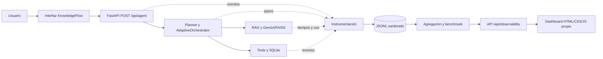

# Arquitectura EP3 — Dashboard propio

> El diagrama y boceto siguientes conservan la propuesta inicial. Implementación local actual: SQLite (Hito 3), rutas autenticadas `/dashboard/api/*` y HTML protegido fuera de static (Hito 4). Ver [contrato y límites actuales](14-dashboard-web.md).

## Base migrada del agente

- `app/main.py`, `app/api/agent_routes.py`: FastAPI y `POST /api/agent`.
- `app/agentic/{orchestrator,planner,state}.py`: estado, planificación y ejecución adaptativa.
- `app/rag/`, `app/tools/`: recuperación/generación y herramientas de consulta/escritura.
- `app/memory/`, `app/storage/`: memoria, persistencia de incidentes.
- `app/evaluation/`: métricas y benchmark RAG previos reutilizables.
- `app/ui/static/`: frontend existente HTML/CSS/JS. Se debe conservar y ampliar.

## Diseño objetivo



## Módulos nuevos sugeridos

- `app/observability/`: esquema de eventos, reloj monotónico, correlación, sanitización, almacenamiento y consultas.
- `app/api/observability_routes.py`: endpoints **solo lectura** (resumen, series, ejecuciones, traza individual), paginados y con acceso controlado.
- `app/ui/static/observability.html`, `observability.css`, `observability.js`: vistas y visualizaciones.
- `tests/test_observability_*.py`: contrato, instrumentación, permisos y filtros.
- `evaluation/agentops/`: benchmark, fixtures y resultados con procedencia identificable.

Los nombres finales quedan sujetos a la auditoría y a la organización existente.

## Pantallas del MVP

1. **Resumen:** solicitudes, precisión evaluada, consistencia, tasa de error, latencia p50/p95 y consumo real de tokens, con unidades y N.
2. **Rendimiento:** evolución temporal, duraciones por componente, comparaciones por escenario.
3. **Ejecuciones:** tabla filtrable por rango, estado, escenario y `trace_id`.
4. **Detalle de traza:** árbol/timeline de `span_id`, `parent_span_id`, operaciones, duraciones y errores, sin datos sensibles.
5. **Calidad:** resultados de benchmark, casos fallidos, cobertura y clasificación de ejecución `offline/mock/live`.

## Contratos no negociables

- Los endpoints deben consultar únicamente datos permitidos y redactados; nunca devolver prompts completos ni API keys.
- El dashboard es de diagnóstico y **no** debe exponer acciones para modificar incidentes.
- La falta de datos debe mostrar **N/D**, no 0% o 100%.
- El tipo de dataset/ejecución debe aparecer visible; los datos sintéticos llevan aviso **DATOS SINTÉTICOS**.
- La instrumentación no debe cambiar respuestas API, permisos ni comportamiento del agente.
- No incorporar React ni nuevas dependencias en el MVP salvo que la auditoría muestre una necesidad concreta.
- Documentar latencia de cada capa y limitar cardinalidad de etiquetas.

## Boceto inicial

```text
KnowledgeFlow / AgentOps
┌───────────────┬─────────────────────────────────────────────────────────┐
│ Navegación    │ Solicitudes   Precisión   Errores   Latencia p95        │
│ - Agente      ├─────────────────────────────────────────────────────────┤
│ - Dashboard   │ Latencia por tiempo       │ Latencia por componente  │
│ - Ejecuciones ├─────────────────────────────────────────────────────────┤
│ - Calidad     │ Errores por escenario     │ Estado de ejecuciones    │
│               ├─────────────────────────────────────────────────────────┤
│               │ Trazas filtrables: ID, fecha, estado, duración          │
└───────────────┴─────────────────────────────────────────────────────────┘
```

**Estado:** dashboard local implementado; validación visual en navegador pendiente por restricciones del entorno. Ver docs/14 para evidencia ejecutada.
